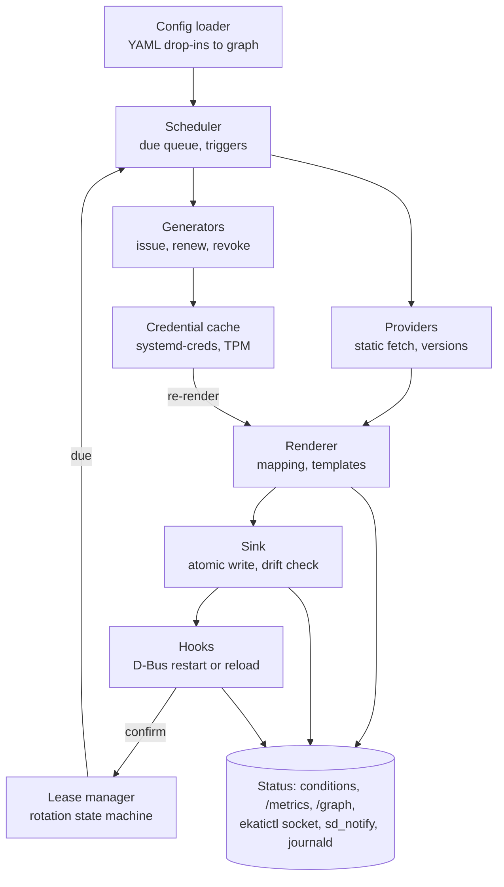

# ADR-0001: ekati — host-level external secrets reconciler

Date: 2026-10-22 · Author: Pantelis

## Status and context

**Status:** Proposed.

We will build `ekati`, a resident host daemon that gives non-Kubernetes hosts External Secrets Operator semantics: declarative secret-to-path specs, continuous sync, dynamic credentials, push, and ESO-style status.

NAS services consume secrets as systemd credentials (`/etc/credstore*`). Those secrets live in Bitwarden Secrets Manager today, and may also live in AWS Secrets Manager or Vault. ESO cannot run without a Kubernetes API. No maintained host-level tool covers multiple providers with reconcile semantics, leases and status:

- [vmes](https://github.com/external-secrets/vmes) (ESO org) reuses ESO providers off-Kubernetes but writes env files only and appears stalled.
- Vault Agent, Infisical Agent and `bws run` each serve a single backend.
- [Teller](https://github.com/tellerops/teller) is multi-provider but a one-shot developer CLI with no daemon, refresh, leases or status.

The name `ekati` is the modern Greek pronunciation of Εκάτη (Hecate). Her epithet Kleidouchos means key-bearer, and she guards gates and crossroads: one daemon standing where several secret providers meet.

## Decision

`ekati` is a long-running Rust daemon (`Type=notify`) plus a `ekatictl` CLI, configured by an ESO-shaped YAML subset.

### Language: Rust

- Bitwarden's Secrets Manager SDK is native Rust (`bws` is built on it). The Go SDK (`sdk-go`) is a cgo wrapper around the same library.
- `aws-sdk-secretsmanager` is official. Vault gets a thin hand-rolled `reqwest` client (login, token renew, KV read/list/metadata, lease renew/revoke), not the community `vaultrs`.
- Depend on the top-level `bitwarden` crate, pinned exactly. Its inner crates (`bitwarden-sm` etc.) are marked internal, so upgrades are expected to break.

### Process model

A resident reconciler, not a timer. Per-resource refresh intervals, drift repair, lease scheduling and live status all need it.

Triggers: resource due, config change (inotify / SIGHUP), target drift (inotify), `ekatictl sync`.



Static values flow providers → renderer → sink; dynamic ones go through generators and the encrypted cache. Hook success feeds back to the lease manager, which alone decides when an old credential is revoked.

### Process contract

From the first runnable version, configuration location, signals and logging are fixed behaviour, not later polish.

- **Config is always an argument:** `ekati --config /etc/ekati`. No compiled-in path. The directory holds `ekati.yaml` (daemon settings: path allowlist, metrics address, state directory) and `secrets.d/` (all resources).
- **Arguments** (`clap`, each with a `EKATI_*` environment equivalent): `--config <dir>` (required), `--state-dir` (default `$STATE_DIRECTORY`), `--http-addr`, `--log-level`, `--log-format text|json|journald`, `--shutdown-timeout` (default 30s), `--check` (validate, print the graph, exit non-zero on errors), `--once` (one reconcile pass, then exit).
- **SIGTERM / SIGINT:** log receipt, stop scheduling, let in-flight writes and hooks finish within the shutdown timeout, persist state, send `STOPPING=1`, exit 0. A second signal forces exit with a logged warning. Shutdown never revokes leases.
- **SIGHUP:** reload and validate. An invalid config is logged and rejected, and the previous one keeps running. A valid reload logs added, changed, removed and tombstoned resources.
- **Logging:** every signal, reload and condition transition is a structured event.
- **Exit codes:** 0 clean shutdown, 1 invalid config at start, 2 fatal runtime error (for example, state not writable).

### Daemon config: `ekati.yaml`

All daemon knobs live in `<config>/ekati.yaml`; resources never do. Precedence: CLI flag > `EKATI_*` environment > `ekati.yaml` > built-in default. The config directory itself comes only from `--config` or `EKATI_CONFIG`.

```yaml
apiVersion: ekati/v1
kind: DaemonConfig

log:
  level: info                  # trace | debug | info | warn | error
  format: journald             # text | json | journald

state:
  dir: /var/lib/ekati          # default: $STATE_DIRECTORY
  cache: true                  # false: no cache; runtime-only hosts need no TPM
  cacheDir: /var/lib/ekati/cache   # survives reboot: TPM-sealed

listen:
  http: 127.0.0.1:9479         # /metrics and /graph; also --http-addr
  socket: /run/ekati/control.sock   # ekatictl

paths:
  runtimeRoot: /run/ekati      # default target root; plaintext, no TPM
  allowedTargets:              # mirrored by ReadWritePaths= in the unit
    - /run/ekati
    - /etc/credstore.encrypted # persistent: systemd-creds format only

reconcile:
  defaultRefreshInterval: 1h   # when a resource sets none
  jitter: 10%
  maxConcurrent: 4
  shutdownTimeout: 30s
  backoff: { initial: 5s, max: 10m }

drift:
  watch: true                  # inotify on targets
  fullVerifyInterval: 6h       # decrypt-and-compare pass

hooks:
  timeout: 60s

leases:                        # defaults; a Generator may override
  renewAt: 66%
  reissueBefore: 10m
  overlap: 5m
  expiryWarning: 1h            # LeaseExpiring threshold

credentials:
  systemdCreds:
    withKey: tpm2              # tpm2 | host+tpm2 | host (host needs allowWithoutTpm)
  allowWithoutTpm: false       # surviving material only; /run targets never use TPM
```

On SIGHUP every section reloads except `state` and `listen`. Changes to those are logged as requiring a restart, and the running values stay in effect. `--check` validates this file together with `secrets.d/`.

### Resource model

An ESO-shaped subset under `apiVersion: ekati/v1`. Every resource of every kind lives as a file in one drop-in directory, `secrets.d/` under the `--config` directory, so each consumer ships its own files. Files are never deleted to remove a resource; they stay as tombstones (see Lifecycle and tombstones).

| Kind | Purpose |
| --- | --- |
| `SecretStore` | Provider, auth, defaults, `readWrite` flag |
| `ExternalSecret` | Remote refs or generator → target path |
| `Generator` | Issues credential sets (passwords, Vault dynamic, STS) |
| `PushSecret` | Local or generated value → provider |

The main difference from ESO: `target` is a file path with format, owner and mode, not a Kubernetes Secret.

```yaml
apiVersion: ekati/v1
kind: ExternalSecret
metadata: { name: foo-db }
spec:
  secretStoreRef: { name: bitwarden-nas }
  refreshInterval: 15m
  target:
    path: /etc/credstore.encrypted/foo-db
    format: systemd-creds        # raw | systemd-creds | env
    owner: root:root
    mode: "0600"
    creationPolicy: Owner        # Owner | Merge | Orphan
    deletionPolicy: Retain       # Retain | Delete
    template: "postgres://app:{{ password }}@db:5432/app"
  data:
    - secretKey: password
      remoteRef: { key: FOO_DB_PASSWORD }
  onChange:
    - systemd: { unit: foo.service, action: try-restart }
```

### Validation at load

Resources form a desired-state graph, validated before anything runs. The loader rejects:

- cycles, such as a PushSecret writing a path that an ExternalSecret on the same host reads;
- a PushSecret against a store not marked `readWrite`;
- targets outside the configured path allowlist;
- two resources claiming the same target.

The loader compiles the YAML into an internal graph IR. Validation, scheduling and the `/graph` status view all work from that IR, so another config front end (for example HCL) could be added later without changing the engine.

### Lifecycle and tombstones

Destructive actions happen only from an explicit tombstone, never from a file that disappeared.

```yaml
apiVersion: ekati/v1
kind: ExternalSecret
metadata:
  name: foo-db
  tombstone: true      # run deletionPolicy once, then report Deleted
spec: { ... }
```

- **Tombstoned resource:** its `deletionPolicy` runs once (Retain releases ownership; Delete removes the target, revokes leases or soft-deletes the pushed value), then it reports `Deleted`. The file stays in `secrets.d/` as the record of intent.
- **File gone without a tombstone:** treated as lost config, not intent. The resource becomes `Orphaned`: refresh stops, targets and leases stay as they are, and a condition and metric are raised.
- **Package uninstall:** leaves every target, lease and pushed value untouched. Removing the package is not a tombstone, and by then the secrets have already been delivered. Explicit teardown is deferred (see After v0.1).
- **Why:** a wiped directory, a bad deploy, a partial config sync or a package removal cannot trigger mass deletion or revocation.

## Providers, credentials and push

Providers sit behind one capability-aware trait; the scheduler works from a normalized credential lifecycle, never per-provider logic.

### Provider contract

```rust
trait SecretProvider {
    fn capabilities(&self) -> Caps;   // list/find, batch, versions, leases, push, cas, ownership_metadata
    async fn fetch(&self, refs: &[RemoteRef]) -> Result<Vec<Fetched>>;  // batched per store
    async fn find(&self, q: &FindQuery) -> Result<Vec<Fetched>>;        // ESO dataFrom.find
    async fn version(&self, r: &RemoteRef) -> Result<Option<Version>>;  // cheap change probe
    async fn push(&self, r: &RemoteRef, v: &SecretBytes, o: &PushOpts) -> Result<PushResult>;
    async fn delete(&self, r: &RemoteRef, owner: &Owner) -> Result<()>;
}
struct Fetched { value: SecretBytes, version: Version, lease: Option<Lease> }
```

`RemoteRef` carries ESO's `property` field to extract one key from a JSON secret.

|  | Bitwarden SM | AWS Secrets Manager | Vault |
| --- | --- | --- | --- |
| Fetch | list whole project, 1 call | `BatchGetSecretValue` (20 per call) | per-path read |
| Version | `revisionDate` | `VersionId` / `AWSCURRENT` | KV v2 metadata version |
| Find | client-side filter | `ListSecrets` by name/tag | KV `LIST` |
| Push / CAS | create/edit, no CAS, no metadata | `PutSecretValue`, compare `VersionId` (racy) | KV v2 `cas`, `custom_metadata` |
| Leases | no | no | yes (dynamic engines) |
| Bootstrap auth | machine account token | IAM Roles Anywhere (X.509, TPM key) | TLS cert auth or AppRole, periodic token |

Each store has its own condition, rate limiter and circuit breaker, so one backend's outage degrades only the resources that reference it. An `ExternalSecret` may mix stores per `data` entry (`sourceRef`); it renders only when every input is fresh, never as a partial.

### Credential classes

| Class | Examples | Refresh driver | Revocable |
| --- | --- | --- | --- |
| Static | Bitwarden, AWS SM, Vault KV | `refreshInterval` + version probe | n/a |
| Leased | Vault database / AWS / SSH engines | lease TTL: renew, reissue at max TTL | yes |
| Expiring | STS AssumeRole, Vault PKI, ECR tokens | hard expiry, reissue only | no |

A `Generator` issuance is atomic: all fields of one credential set come from the same lease.

### Rotation rules

- The old credential is revoked only after the new one is written, its `onChange` hooks succeed, and the `overlap` window has passed. Hook failure holds both leases valid (`RotationBlocked`).
- Never revoke on daemon stop or restart; only on resource deletion with `revokeOnDelete`.
- The new lease ID is persisted before any write, so a crash mid-rotation resumes or rolls back without orphaning either lease.
- An expired lease keeps its file, sets `Ready=False reason=LeaseExpired`, and fires an optional `onExpire` hook.
- **Vault token parent:** dynamic leases die with the token that issued them. The daemon uses a periodic token renewed indefinitely; a forced re-login is treated as a fleet-wide rotation and completed before the old token expires.

### Push

- **Ownership:** KV v2 `custom_metadata` (`managed-by=ekati`, `ekati-host=<machine-id>`, `ekati-resource=<name>`). Unowned paths are never overwritten (`PushConflict`).
- **Concurrency:** every write uses CAS against the last version ekati wrote. A content HMAC suppresses no-op writes so KV versions are not burned.
- **Ordering for generated values:** generate → credential cache → remote push → local targets → hooks. A failed push leaves local targets untouched.
- **Least privilege:** pushes use a separate store and auth role, with a Vault policy templated on the host's identity so each host writes only its own subtree.
- **Deletion:** `deletionPolicy: Delete` soft-deletes, and only when ownership still matches. Destroy is opt-in.

## Sinks, status, persistence and security

On any failure, ekati keeps the last good file and reports it as not ready. It never deletes or truncates because of an empty or failed provider response.

### Target classes

TPM sealing applies only to what survives a reboot. Runtime targets under `/run` are plaintext on tmpfs and are never sealed.

| Class | Where | Formats | TPM |
| --- | --- | --- | --- |
| Runtime (default) | `/run/ekati/` (`paths.runtimeRoot`) | `raw`, `env`; mode 0400, per-consumer owner | never |
| Persistent | anywhere outside `/run`, e.g. `/etc/credstore.encrypted/` | `systemd-creds` only | required |

- **Plaintext outside `/run` is invalid.** A `raw` or `env` target outside `/run` fails validation: an error is logged with the resource name and path, the resource is rejected (`InvalidSpec`) and nothing is written. `--check` fails on it.
- **`RuntimeDirectory=ekati` + `RuntimeDirectoryPreserve=yes`** in the unit. Without preserve, systemd wipes `/run/ekati` whenever ekati stops, so an upgrade or crash would delete every consumer's secrets.
- **Consumers** read runtime secrets via `LoadCredential=<name>:/run/ekati/<name>`, so systemd copies each into a private per-service ramfs, and declare `After=` + `Requires=ekati.service`.
- **Boot:** `/run` starts empty. `READY=1` is sent only after the first reconcile of runtime targets, from the credential cache when the provider is unreachable, or after the first successful fetch when the cache is disabled.
- **Swap:** `/run` is tmpfs and can be swapped. On hosts with unencrypted swap, a runtime secret can reach disk; encrypted or no swap is a deployment requirement.

### Sinks and hooks

- **Formats:** `raw`, `systemd-creds` (shells out to the `systemd-creds` binary, which owns TPM2/host-key selection), `env`.
- **Writes:** temp file in the target's directory, fsync, owner/mode set, atomic rename.
- **Ownership:** state records which paths ekati manages. `creationPolicy: Owner` refuses to clobber an unmanaged file (`TargetConflict`), which is what makes `deletionPolicy: Delete` safe.
- **Drift:** an HMAC of the rendered content (per-host key) is compared every tick. A full decrypt-and-compare runs at startup and every N hours, because TPM unseals are slow. An inotify event on a target triggers immediate repair.
- **Hooks:** `onChange` actions go over D-Bus (`zbus`), not an exec'd `systemctl`, and run only on actual change. Failures surface as `HookFailed`; for rotations, hook success is the confirmation that allows revocation.

### Status

Conditions follow ESO: `Ready`, `reason`, `message`, `lastTransitionTime`, `refreshTime`, `syncedVersion`.

| Surface | What it carries |
| --- | --- |
| `/graph` | The graph IR as JSON (nodes, edges, each node's condition), plus a small embedded page that draws it coloured by condition. A not-ready target traces back along its edges to the failing store or generator. |
| `/metrics` | ESO-compatible names (`externalsecret_status_condition`, `externalsecret_sync_calls_total`, `_error`) plus `ekati_lease_expiry_timestamp_seconds`, `ekati_rotations_total{result}`, `ekati_push_total{result}`, `ekati_leases_active` |
| Control socket | `ekatictl get / describe / sync` |
| `sd_notify` | `READY=1`, `STOPPING=1`, `STATUS=` summary line, watchdog |
| journald | Structured logs, one event per condition transition, signal and reload |

Reasons in use: `SecretSynced`, `SecretSyncedError`, `InvalidSpec`, `TargetConflict`, `HookFailed`, `Rotating`, `RotationBlocked`, `LeaseExpiring`, `LeaseExpired`, `RevokeFailed`, `TokenRenewFailed`, `PushConflict`, `PushFailed`, `OwnershipLost`, `Orphaned`, `Deleted`.

### Persistence

- **State file** (no secret material): managed paths, content HMACs, lease records (ID, generator, issue time, TTL, max-TTL deadline, phase, targets), last pushed versions. On startup, leases are rehydrated and checked with a lookup instead of being reissued.
- **Credential cache** (`state.cache`, default on): issued and fetched values sealed with `systemd-creds` under `/var/lib/ekati/cache/`. A template or target change, or a reboot while the provider is unreachable, re-renders runtime targets without a new fetch or issuance. With `state.cache: false`, nothing is cached: a host with only runtime targets needs no TPM at all, and consumers wait at boot until the first fetch succeeds.
- **TPM enforced for surviving material:** persistent targets, the credential cache and the state HMAC key. If any of these is configured and no TPM is present, the daemon refuses to start (exit 2) unless `credentials.allowWithoutTpm: true`; it then falls back to the host key, logs a warning, and reports `ekati_tpm_backed 0`. Runtime-only material never needs a TPM.

### Security

- Bootstrap credentials arrive via `LoadCredentialEncrypted=`, never as environment variables.
- A target path allowlist in the main config, mirrored in the unit by `ProtectSystem=strict` + `ReadWritePaths=`.
- Config files writable by anyone other than root are rejected at load.
- **Opaque secret type** (borrowed from Grafana Alloy): fetched values are a distinct type that cannot be formatted, logged or serialized. Only the sink can write the bytes, and only templates can embed them. `/graph`, logs and metrics see names and conditions, never values.
- Secret values wrapped in `secrecy`/`zeroize`; `LimitCORE=0`, `MemoryDenyWriteExecute=yes`.
- No secret values or derived material in logs or metric labels.

## Alternatives considered

Each option below either covers one backend, runs once, or needs Kubernetes; none combines reconcile, leases and status on a host.

| Option | What it gives | Why not |
| --- | --- | --- |
| `bws` + systemd timer script | Works today for one NAS, \~40 lines | No status, leases, push or multi-provider. Kept as the interim until M5. |
| k3s + ESO in a VM | Real ESO | Consumers must move into k3s, or a bespoke Secret→file bridge is needed. Bitwarden provider also needs `bitwarden-sdk-server` + cert-manager. |
| [vmes](https://github.com/external-secrets/vmes) | ESO providers off-Kubernetes | Env-file output only; basic sink options still on its roadmap; appears stalled. Go, so Bitwarden via `bitwarden-sdk-server`. |
| Vault Agent | Templates, lease renewal | Vault only; no hook-confirmed revocation; no condition-style status. |
| Infisical Agent, `bws run` | Host delivery | Single backend each. |
| [Teller](https://github.com/tellerops/teller) | Multi-provider Rust CLI, put/delete/copy | One-shot, no daemon or status; `teller-providers` lacks versions, CAS, ownership, leases. Used as implementation reference only. |
| Alloy-style config language (HCL-like, expressions) | Dependencies as expressions; composition without a separate template engine | Loses ESO portability with Kubernetes clusters. Dataflow propagation does not model rotation transactions, so leases would still need a separate engine. Weaker schema validation and generation than YAML. `/graph` and the opaque secret type are adopted; the language is not. HCL can be a later front end onto the same IR. |
| Go implementation | Official Vault and AWS clients | Bitwarden only through cgo; no static musl build. |

## Consequences

The value is in what no host tool does well today; for a single NAS alone, the interim timer script would suffice.

**Gains**

- One secret model across the NAS and Kubernetes clusters: same resource kinds, same status semantics, same dashboards.
- Differentiated features: hook-confirmed rotation with overlap, condition-style status off Kubernetes, push with ownership and CAS.
- A reusable provider + renderer core that can later back a developer mode (`run`, `template`, `scan`, `redact`) from the same YAML.

**Costs**

- Ownership of security-critical code, including vulnerability response.
- Provider maintenance across three APIs; `bitwarden` crate upgrades expected to break; Vault client hand-maintained.
- Lease handling is the hardest part to get right and the costliest to get wrong: a bug can take down every consumer at once.
- TPM unseal latency bounds how often full drift verification can run.

## Milestones

The control loop is proven against a fake provider before any real backend; Bitwarden in M5 retires the interim timer, and M6 is the first release.

1. **M1 — Repository foundation**
   - Cargo workspace: `ekati-core` (model, graph IR, scheduler, state), `ekati-providers`, `ekati-sinks`, `ekati` (daemon), `ekatictl` (CLI).
   - `flake.nix` with dev shell and package build; `rust-toolchain.toml`.
   - CI: fmt, clippy `-D warnings`, tests, `cargo-deny`, `cargo-audit`.
   - Packaging stubs only: `cargo-deb` metadata, `packaging/systemd/`, `docs/adr/` with this ADR.
   - **Exit:** `nix build` and `cargo build` green in CI.
2. **M2 — Running binary**
   - Full process contract: `clap` arguments with `--config` required, environment equivalents, `--check` and `--once`.
   - Signal handling: SIGTERM/SIGINT drain within the shutdown timeout, forced exit on a second signal, SIGHUP validated reload (invalid config rejected, previous kept, diff logged). Defined exit codes.
   - `tracing` with text, JSON and journald formats; every signal and reload logged. `sd_notify` ready, stopping and watchdog.
   - Loading and schema validation of every resource in `secrets.d/` into the graph IR, including tombstone parsing (no sync yet).
   - `/metrics` with build info, process metrics and loaded-resource counts.
   - **Exit:** `cargo run -- --config examples/` serves `/metrics`; `--check` fails on a broken file; SIGHUP with invalid config keeps the old one; SIGTERM exits 0 with the drain logged.
3. **M3 — Control loop on a fake provider**
   - `kind: fake` as a real provider behind the trait: returns `CHANGEME-<rand>`, with failure injection (latency, error rate, version-bump interval). Stays as a permanent test fixture. Several fake stores run at once under different names, each with its own failure profile, so per-store isolation and cross-store rendering are tested from the start: one failing fake store must leave the others Ready.
   - Scheduler (refresh interval + jitter), `raw` sink with atomic write, owner and mode.
   - State file, ownership and `creationPolicy`; drift detection (HMAC + inotify).
   - Tombstone handling with `deletionPolicy`; `Orphaned` for vanished files.
   - Opaque secret type enforced from the first provider.
   - Conditions, ESO-compatible metrics, `/graph` (JSON and page), control socket and `ekatictl get / describe / sync`.
   - **Exit:** `kill -9` mid-run recovers without rewriting unchanged targets; injected errors show stale-while-error with `Ready=False`; a deleted target is restored; a removed spec file leaves its target and reports `Orphaned`; a tombstone with `Delete` removes the target.
4. **M4 — Rendering and hooks**
   - `data` / `dataFrom` mapping, `property` extraction, `minijinja` templates, cross-store `sourceRef` with the all-fresh rule.
   - `systemd-creds` and `env` sinks.
   - `onChange` hooks over D-Bus with `HookFailed`.
   - **Exit:** a template combining two fake stores lands as a systemd credential, and a dummy unit restarts exactly once per change.
5. **M5 — Bitwarden integration**
   - Bitwarden provider: machine-account token from a systemd credential, one list per store per tick, 429 backoff, `revisionDate` as `syncedVersion`.
   - **Exit:** the NAS project syncs on the real NAS and the `bws` timer is retired.
6. **M6 — Release v0.1**
   - Hardened systemd unit; `.deb` via `cargo-deb` and an apt repository; Nix package and NixOS module; static musl binaries on GitHub releases.
   - Signed artifacts and SBOM.
   - **Exit:** installable from apt and the flake on a clean host.

**After v0.1**

- Vault KV v2 and AWS Secrets Manager providers (with IAM Roles Anywhere).
- `PushSecret` with ownership and CAS.
- `Generator` + lease manager: Vault database engine and STS AssumeRole first.
- Developer mode: `ekatictl run / template`, then `scan` / `redact`.
- Explicit teardown (`ekatictl teardown`): opt-in removal of targets, leases and pushed values before uninstall.

## Open questions

- [ ] Reserve `ekati` and `ekatictl` on crates.io and the GitHub namespace. Web searches found no software using the name, but crates.io was not queried directly.

**Resolved 2026-10-22**

- Name: `ekati`. Rejected: `secretd` (Secret Network's node daemon ships `/usr/local/bin/secretd`), `hekate` (popular Nintendo Switch bootloader, a same-domain Ruby secrets gem, crate name held), `secretsmanager` (collides with AWS and Bitwarden Secrets Manager).
- TPM: enforced for material that survives a reboot (persistent targets, cache, state key), with `credentials.allowWithoutTpm` as an explicit opt-out. Runtime targets under `/run` never use TPM. Plaintext targets outside `/run` are rejected.
- Credential cache: on by default; `state.cache: false` removes the TPM requirement for runtime-only hosts, trading offline boot.
- YAML parser: `serde_yaml_ng`.
- Uninstall: leaves resources alone; teardown deferred to a later milestone.
- HTTP port: 9479 by default, set by `listen.http` or `--http-addr`.
- License: Apache-2.0.
- Multiple stores: supported from M3, exercised with several named fake stores.
